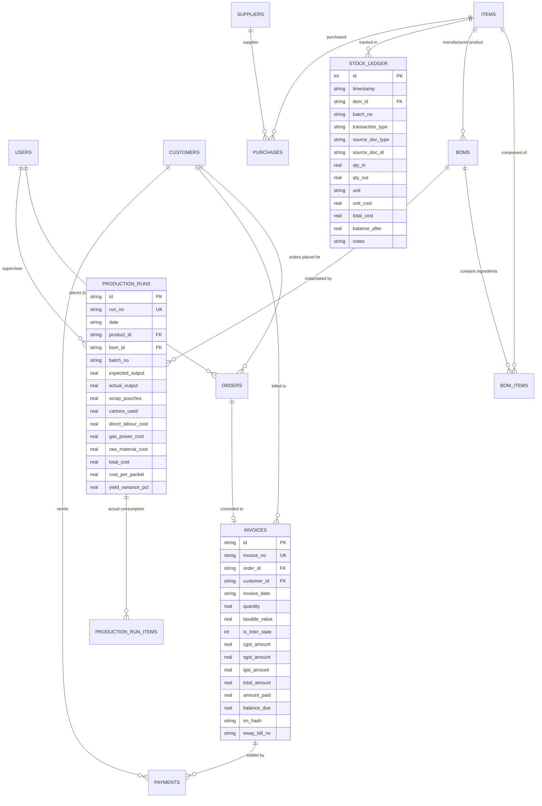

# Architecture & Engineering Design Note: Order-to-Audit System
**Client:** Annapoorna Traditional Foods Pvt Ltd (Packaged South Indian Snacks Manufacturer, Tamil Nadu)  
**Author:** Candidate for Centre for Digital Infrastructure, NIT Tiruchirappalli  
**Stack:** Node.js 24 Native Runtime (`node:http`, `node:sqlite`, `node:crypto`), Zero external runtime dependencies, Vanilla ES6 Reactive SPA with PWA Offline Service Worker.

---

## 1. System Overview & Domain Model

The system solves the fundamental operational disconnect in small-scale food manufacturing by bridging two operational loops through an immutable, audit-grade stock movement ledger:

```
[SALES LOOP]
Salesman Field Order (Mobile / Offline PWA)
   └──> Factory Admin Verification & Stock Coverage Check
          └──> GST Tax Invoice Generated (CGST+SGST / IGST)
                 └──> Dispatch: Finished Goods Stock Decremented
                        └──> Customer Receivables Ledger & Aging

[PRODUCTION LOOP]
Raw Materials Inward (Purchase PO with GST)
   └──> Warehouse Stock Incremented
          └──> Recipe-based Production Run (Bill of Materials)
                 ├──> Planned vs Actual Consumption Deduction
                 ├──> Wastage & Scrap Pouches Deduction
                 ├──> Finished Goods Stock Incremented
                 └──> Overheads Allocation & True Cost Per Packet
```

---

## 2. Entity-Relationship (ER) Diagram



---

## 3. Inventory Mechanics: Ledger-Derived Balance & Traceability

### 3.1 Strict Ledger Immutability
Traditional inventory apps maintain a mutable `current_stock` column that is overwritten on edits, destroying auditability. In this design:
- **No stock number is ever directly updated.**
- Current stock is derived strictly as:
  $$\text{Closing Balance}(item) = \sum \text{qty\_in} - \sum \text{qty\_out}$$
- Every inventory modification generates a permanent, chronological record in `stock_ledger` containing:
  - Source document reference (`PO/2026-27/001`, `PR/2026-27/001`, `ATF/2026-27/001`).
  - Transaction classification (`OPENING`, `PURCHASE`, `PROD_ISSUE`, `PROD_OUTPUT`, `SALES_DISPATCH`).
  - Batch number and calculated running balance.

### 3.2 Atomic Recipe Execution
When a production supervisor logs a batch run:
1. The standard recipe ($BOM$) calculates theoretical requirement:
   $$\text{StdQty} = \text{BOM\_Qty} \times \left(\frac{\text{Actual Output}}{\text{Batch Size}}\right)$$
2. Actual floor issues are deducted from raw material ledger balances.
3. Actual packaging consumed ($\text{Good Packets} + \text{Scrap Pouches}$) is deducted from packaging stock.
4. Finished goods stock is credited with good packets produced.
All ledger movements occur within a single ACID transaction in SQLite.

---

## 4. Production Variance & Tolerance Control

The system implements automated tolerance checks ($\pm 3\%$ standard):
- **Yield Variance:**
  $$\text{Yield Variance \%} = \frac{\text{Actual Output} - \text{Expected Output}}{\text{Expected Output}} \times 100$$
  *Benchmark:* $188 \text{ pkts actual} \text{ vs } 200 \text{ expected} \implies \mathbf{-6.0\%}$ (Flagged in Red Alert).
- **Consumption Variance:**
  $$\text{Consumption Variance \%} = \frac{\text{Actual Consumed} - \text{Standard BOM}}{\text{Standard BOM}} \times 100$$
  *Benchmark (Cooking Oil):* $10.5\text{ L actual} \text{ vs } 10.0\text{ L standard} \implies \mathbf{+5.0\%}$ (Flagged in Amber Alert).

---

## 5. Costing & Valuation Methodology

### 5.1 Direct Materials Valuation (FIFO vs Weighted Average)
Food commodities (flour, oil) experience purchase price volatility. Both methods are supported and audited:
- **FIFO (First-In, First-Out - Default):**
  - Opening stock: $100\text{ kg} @ ₹42/\text{kg}$.
  - Purchase: $60\text{ kg} @ ₹45/\text{kg}$.
  - Consumption for batch ($40\text{ kg}$) is fulfilled entirely from opening stock:
    $$\text{Flour Cost} = 40\text{ kg} \times ₹42.00 = ₹1,680.00$$
- **Weighted Average Alternative:**
  $$\text{Avg Rate} = \frac{(100 \times 42) + (60 \times 45)}{100 + 60} = \frac{4200 + 2700}{160} = ₹43.125/\text{kg}$$
  $$\text{Flour Cost (WA)} = 40 \times 43.125 = ₹1,725.00$$

### 5.2 Direct Overheads Allocation
Overheads directly identifiable with a production run are assigned per batch:
- Direct Floor Labour: $₹1,200.00$
- Gas & Power Utility: $₹600.00$
- Packaging ($188\text{ good} + 6\text{ scrap} = 194\text{ pouches} @ ₹2.50 = ₹485.00$, $9\text{ cartons} @ ₹15 = ₹135.00$).

### 5.3 Batch Cost & Margin Calculation (FIFO Benchmark)
$$\text{Total Material Cost} = ₹1,680 (\text{Flour}) + ₹1,470 (\text{Oil}) + ₹240 (\text{Spices}) + ₹485 (\text{Pouches}) + ₹135 (\text{Cartons}) = \mathbf{₹4,010.00}$$
$$\text{Total Production Cost} = ₹4,010.00 (\text{Materials}) + ₹1,800.00 (\text{Overheads}) = \mathbf{₹5,810.00}$$
$$\text{Cost Per Good Packet} = \frac{₹5,810.00}{188\text{ packets}} = \mathbf{₹30.904} \approx \mathbf{₹30.90}$$
$$\text{Gross Margin per Packet} = ₹50.00 (\text{Selling Price}) - ₹30.90 = \mathbf{₹19.10} \quad \mathbf{(38.20\% \text{ Gross Margin})}$$

---

## 6. GST Tax Compliance & Accounting Integration

1. **Place of Supply Logic (GST Rules):**
   - Factory in Tamil Nadu (State Code `33`).
   - Intra-state (Customer in TN, State `33`): CGST ($2.5\%$) + SGST ($2.5\%$).
   - Inter-state (Customer in KA, State `29`): IGST ($5.0\%$).
2. **GSTR-1 Mapping:**
   - Outward supplies grouped by Table 4 (B2B Supplies) and Table 12 (HSN Code `21069099`).
3. **Audit Trail & Immutability:**
   - All critical actions recorded in `audit_logs` (user, role, timestamp, old/new states).
   - Invoices cannot be deleted; credit notes or status cancellation flags are mandated.
4. **Tally Interoperability:**
   - Generates Tally-compliant XML (`/api/reports/tally-xml`) mapping Party Ledgers, Sales Accounts, and CGST/SGST/IGST Output tax ledgers for zero re-entry at month end.
